# Gatus on AWS ECS Fargate

I containerised Gatus (a health monitoring dashboard) and deployed it on AWS ECS Fargate, with the infrastructure built in Terraform and shipped through GitHub Actions.

## Project overview

Gatus checks websites and services on a schedule and shows whether they're up. I configured it to check AWS, Google, Docker, Terraform and itself.

It runs on a custom domain managed in Route 53, behind an Application Load Balancer with HTTPS.

The app sits in private subnets, and only the load balancer is public, so the app can't be reached directly from the internet. All traffic goes through the load balancer, which redirects HTTP to HTTPS and forwards requests to the app. This reduces risk, because there's only one way in to protect.

I first built everything manually in the AWS console (ClickOps), tore it down, then rebuilt it in Terraform (Infrastructure as Code). Finally, I set up four GitHub Actions pipelines to build, check, deploy and destroy it, logging into AWS with OIDC, so no AWS keys are stored anywhere.

## App demo

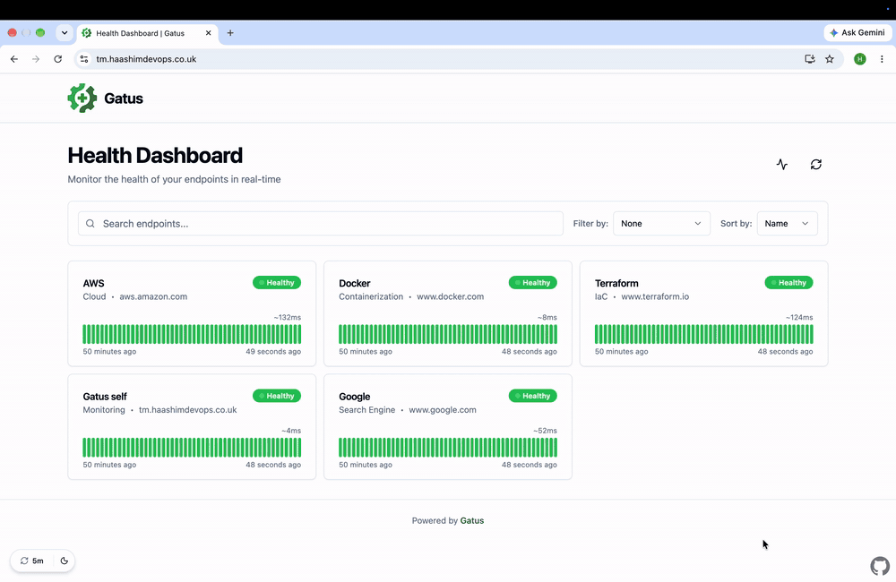

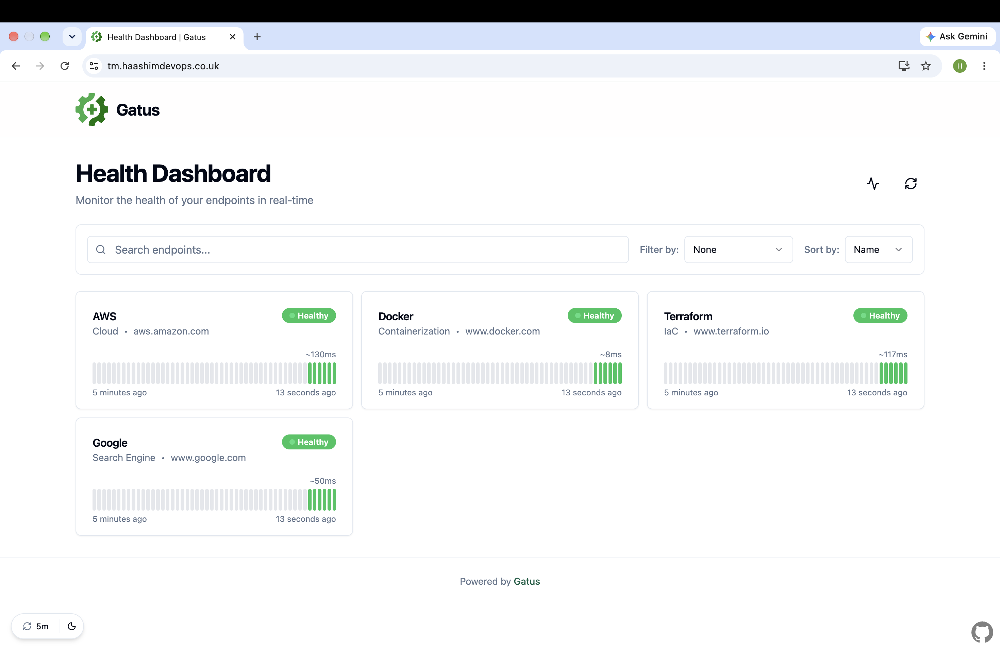
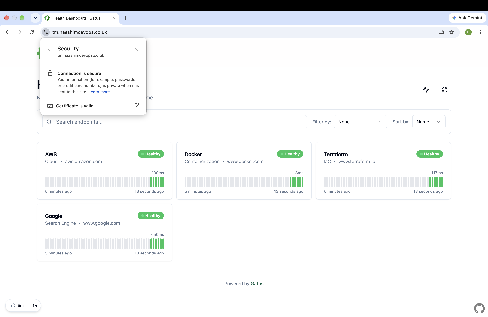
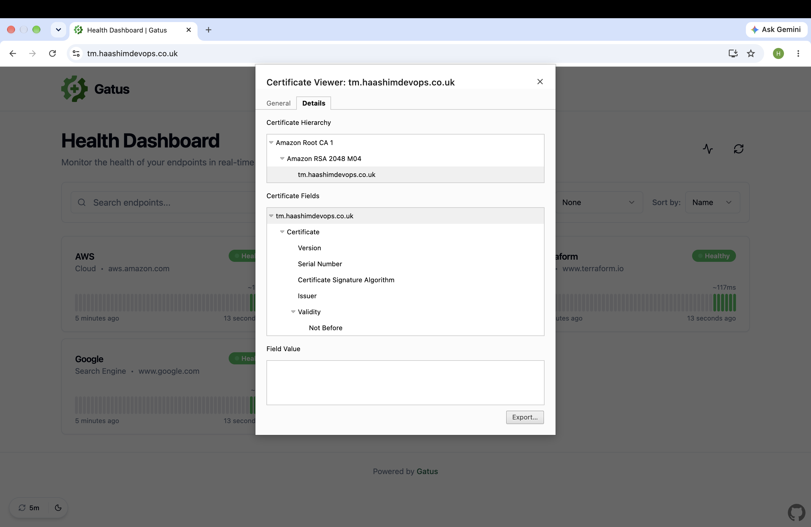


## Architecture

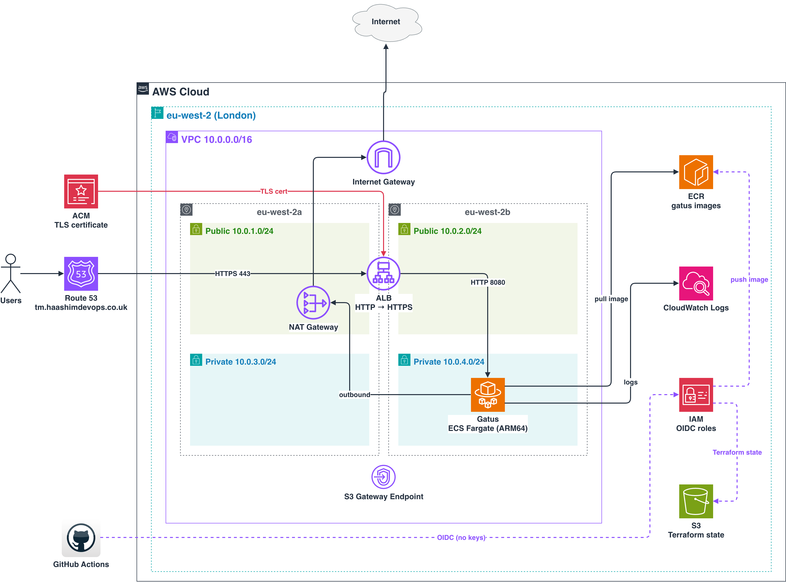


## Project structure

```
Gatus-ECS/
├── .github/workflows/
│   ├── docker.yml
│   ├── terraform-plan.yml
│   ├── deploy.yml
│   └── destroy.yml
├── app/
│   └── config.yaml
├── infra/
│   ├── bootstrap/
│   ├── modules/
│   │   ├── vpc/
│   │   ├── security-groups/
│   │   ├── acm/
│   │   ├── alb/
│   │   ├── ecs/
│   │   └── route53/
│   ├── main.tf
│   ├── backend.tf
│   └── *.tf
├── docs/
├── Dockerfile
├── .dockerignore
└── .gitignore
```

## Local setup

**Prerequisites:**
- Go
- Docker
- AWS CLI
- Terraform
- Git

### Run with Go

From the `app/` folder:

```bash
cd app
GATUS_CONFIG_PATH=config.yaml go run .
```

Then, in another terminal:

```bash
curl http://localhost:8080/health
# {"status":"ok"}
```

The dashboard is at http://localhost:8080.

### Run with Docker

From the repo root:

```bash
docker build -t gatus .
docker run -p 8080:8080 gatus
```

Then check it's healthy:

```bash
curl http://localhost:8080/health
# {"status":"ok"}
```

### Dockerfile choices

- **Multi-stage build:** Go compiles in the first stage, and only the binary goes into the final image. That keeps it small, which means **faster deployments and scaling, lower cost, better security and faster pipelines**.
- **Distroless:** there's no shell or package manager, just the app. There's less for an attacker to use, and Trivy found 0 critical vulnerabilities.
- **Non-root:** the app doesn't run as root, which limits the damage if something goes wrong.
- **`CGO_ENABLED=0`:** the binary is self-contained, which distroless needs.
- **ARM64:** it builds natively on a Mac (which I used), and ARM Fargate is cheaper than x86.

## Infrastructure (Terraform)

I split the Terraform into two parts.

I run **`infra/bootstrap/`** once from my laptop. It creates the S3 bucket for Terraform state and the IAM roles GitHub uses to log in. The pipelines need these before they can do anything, so they live outside the main stack and don't get deleted when I tear it down.

**`infra/`** is the main stack, which the pipelines build and destroy.

### Modules

Each part of the infrastructure has its own module:

- **`vpc`:** the network, with public and private subnets across two AZs
- **`security-groups`:** firewall rules for the load balancer and the app
- **`acm`:** the HTTPS certificate
- **`alb`:** the load balancer, which redirects HTTP to HTTPS
- **`ecs`:** the cluster and service that run Gatus
- **`route53`:** the DNS record for the domain

### State and locking

Terraform state is stored remotely in S3, so the pipelines and my laptop all share the same state:

```hcl
terraform {
  backend "s3" {
    bucket       = "gatus-380592535435-eu-west-2-tfstate"
    key          = "gatus/terraform.tfstate"
    region       = "eu-west-2"
    encrypt      = true
    use_lockfile = true
  }
}
```

`use_lockfile = true` turns on S3's built-in locking, so I didn't need a DynamoDB table. While a run is happening, a `.tflock` file stops anything else from changing the state at the same time.

The bucket is versioned and encrypted, blocks public access, and has `prevent_destroy` on, so it can't be deleted by mistake.


## CI/CD pipelines

There are four GitHub Actions workflows:

- **`docker.yml`:** builds the image, scans it with Trivy and pushes it to ECR. It runs when the app changes.
- **`terraform-plan.yml`:** checks the Terraform and shows the plan. It runs on pull requests.
- **`deploy.yml`:** applies Terraform and checks the site is healthy. It runs after a merge or a new image.
- **`destroy.yml`:** tears everything down. It only runs manually, after you type `destroy`.


### How a change gets to production

I work on a branch and open a pull request. The plan workflow runs and shows me exactly what's going to change before anything happens. When I merge the pull request into `main`, the right pipelines run on their own: an app change builds a new image, and as soon as that succeeds, the deploy picks it up straight away. The last step checks `/health` on the live site, and if it doesn't come back healthy, the pipeline fails.

To test it end to end, I added a self-monitoring endpoint to `config.yaml` and merged it. It took me three tries to get the health condition right (I'd guessed `UP`, then `OK`, before checking the real response and finding it was `ok`), but each time the change went from merging into `main` to the live dashboard without me touching anything.


### Keeping the pipelines fast

- **Path filters:** README changes don't trigger anything.
- **Native ARM runners:** the image builds on ARM directly, with no slow emulation.
- **Docker layer cache:** unchanged layers are reused between runs.
- **Parallel jobs:** lint, security and plan run at the same time (about 25 seconds in total).
- **Terraform only changes what's different:** a full build takes about 3 minutes, but an app update applies in about 6 seconds.

### Screenshots

**Docker build and push (with the Trivy report saved as an artifact)**
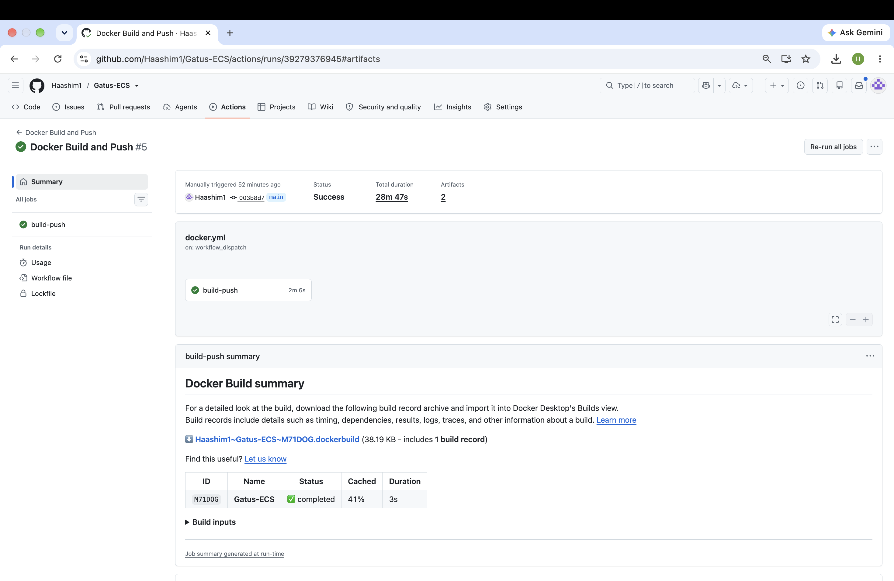
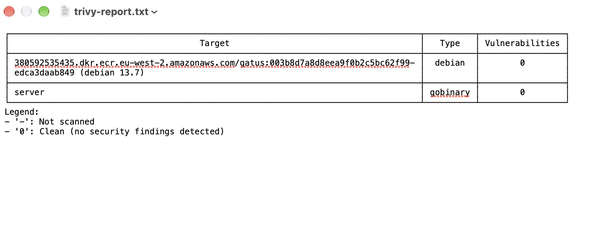

**Terraform plan on a pull request**
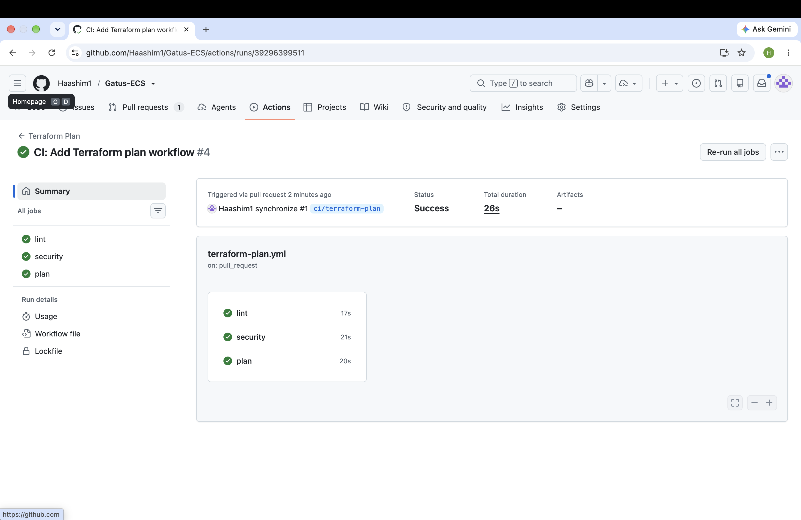
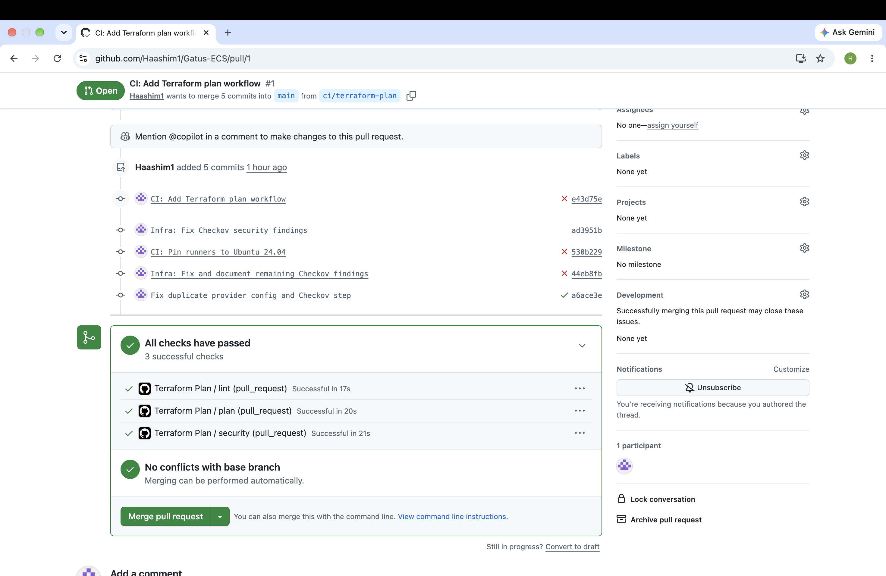

**Deploy, including the health check**
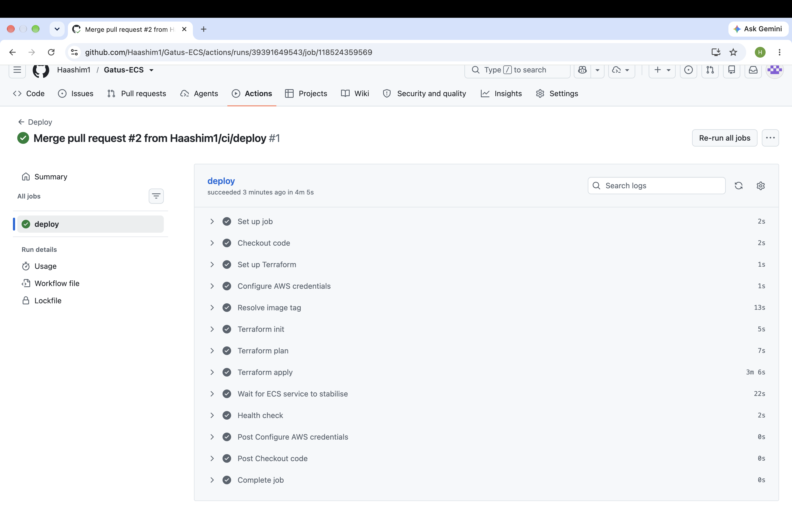

**End to end: a config change building and deploying automatically**
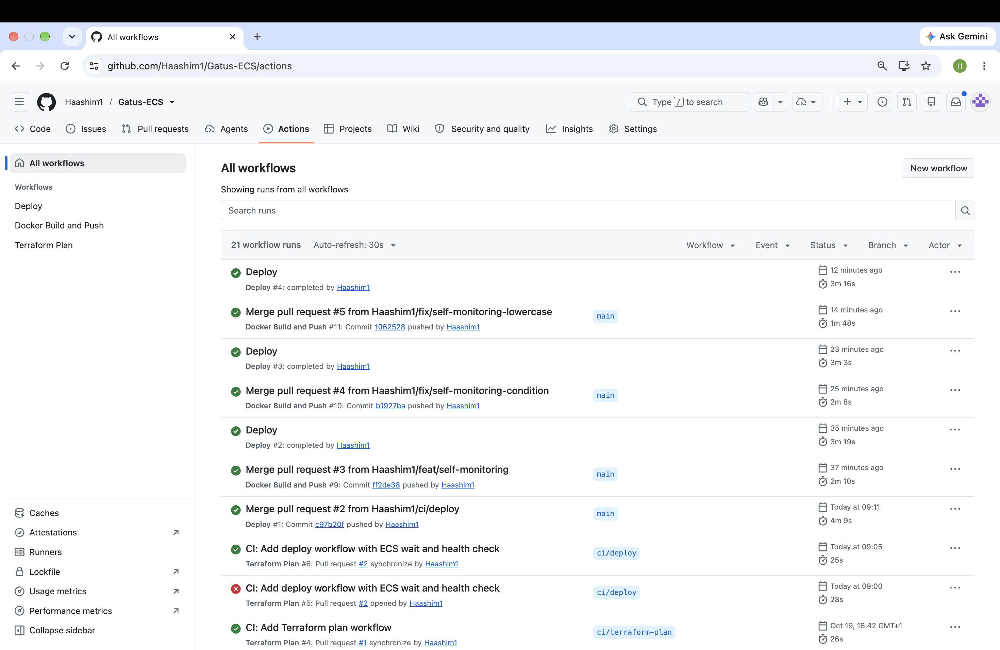
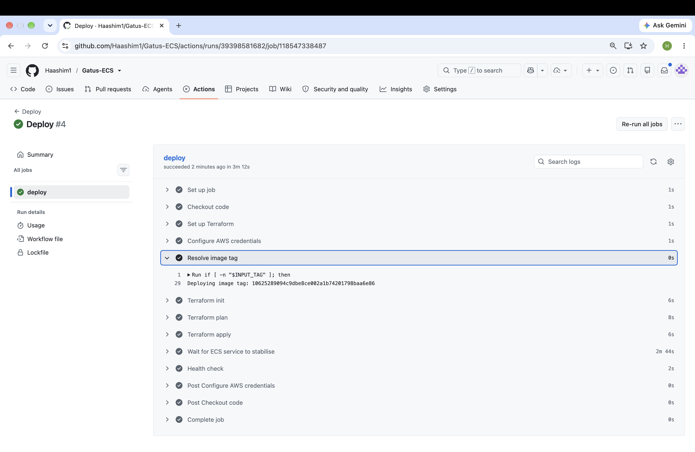
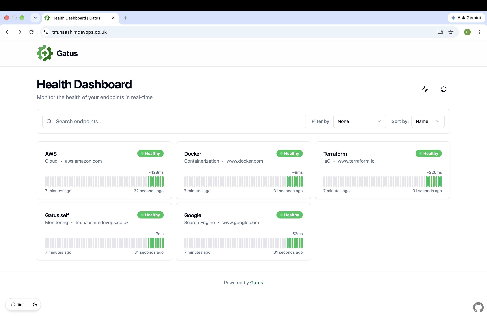

**Destroy**
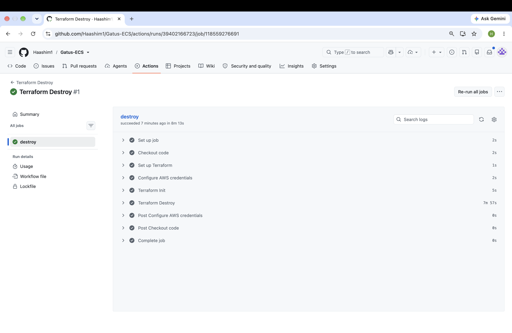

## Security

**No stored AWS keys.** GitHub logs into AWS with OIDC, so there are no access keys anywhere. Each run gets temporary credentials, and AWS only trusts runs from this repo. I used GitHub's newer immutable subject format, which ties the trust to the repo's numeric ID, so if someone deleted and recreated a repo with the same name, it still wouldn't be trusted.

**Least privilege.** There are two CI roles rather than one admin role. The ECR role can only push to the `gatus` repo, and only from `main`. The Terraform role has `PowerUserAccess` (which excludes IAM), plus permission to manage `gatus-dev-*` roles only, so it can't change its own permissions.

**Network.** The app sits in private subnets and only accepts traffic from the ALB on port 8080. HTTP redirects to HTTPS using TLS 1.3, and the VPC's default security group is locked down.

**Image.** The image is distroless and runs as non-root. Trivy scans every build (0 critical vulnerabilities), and ECR tags are immutable, so an image can't be overwritten.

**Scanning.** Checkov (which checks the Terraform for security misconfigurations) and tflint (which catches Terraform mistakes and bad practices) run on every pull request. I fixed the Checkov findings that made sense, and skipped the rest with a written reason next to each one. Most of those are things like WAF and flow logs, which cost extra and I'd turn on in production.

**Supply chain.** Every action is pinned. Trivy is pinned to a commit SHA. Main is protected, so all changes go through pull requests.

## Design decisions

**No database.** I originally set it up with RDS Postgres, but it added about 10 minutes to every deploy and destroy and was more costly. The brief didn't need it, so I took it out. The downside is that check history resets on every deploy. For a real setup, I'd add it back.

**One task.** Gatus doesn't share work between copies, so running two would just mean every check runs twice.

**One NAT gateway.** Two would double the cost. If that AZ goes down, the app loses outbound access, which is fine for this project but not for production.

**ARM64.** It's cheaper on Fargate and builds natively on my Mac.

**ClickOps first.** Building it manually first in the console before writing any Terraform helped me understand how the pieces fit together.

## Lessons learned

**GitHub changed the OIDC format.** My first pipeline run failed with "not authorized to assume role", even though the trust policy looked right. GitHub now adds numeric IDs to the subject claim for repos created after July 2026, so `repo:Haashim1/Gatus-ECS` no longer matched. Updating the trust policy to the new format fixed it.

**Trivy was scanning for the wrong platform.** The build pushed fine, but Trivy failed because it looked for an x86 image and mine is ARM64 only. Setting `TRIVY_PLATFORM=linux/arm64` fixed it.

**Local and CI scans didn't match.** Checkov found nothing on my laptop, but 10 issues in CI. The pipeline was running a newer version with more checks. Now I compare versions first when results differ.

**Check the real response before writing a condition.** My self-monitoring check failed twice. Running `curl` showed the real value was `ok` and not `OK`. Gatus matches values exactly, so the case mattered.

**Small typos break pipelines.** I incorrectly typed `Gatus` instead of `gatus` (Docker image names must be lowercase). Later I typed `deploy` into the image tag box, and ECS spent 10 minutes trying to pull an image that didn't exist. The pipeline caught it, but it showed me why it's worth checking inputs early.

## Cost

The NAT gateway and the load balancer cost money every hour they’re running, even when nobody's using the site, so I destroy the stack after each session and redeploy it with one pipeline run when I need it.

What stays up between sessions costs isn't costly: the Route 53 hosted zone ($0.50 a month), the ECR images, and the state bucket. I also set up an AWS budget alert, so I get an email if costs go above what I expect.
